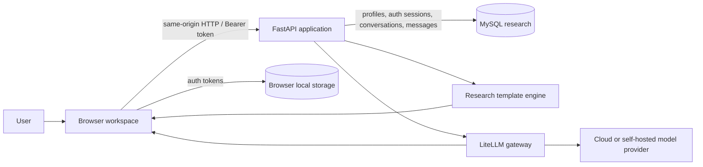
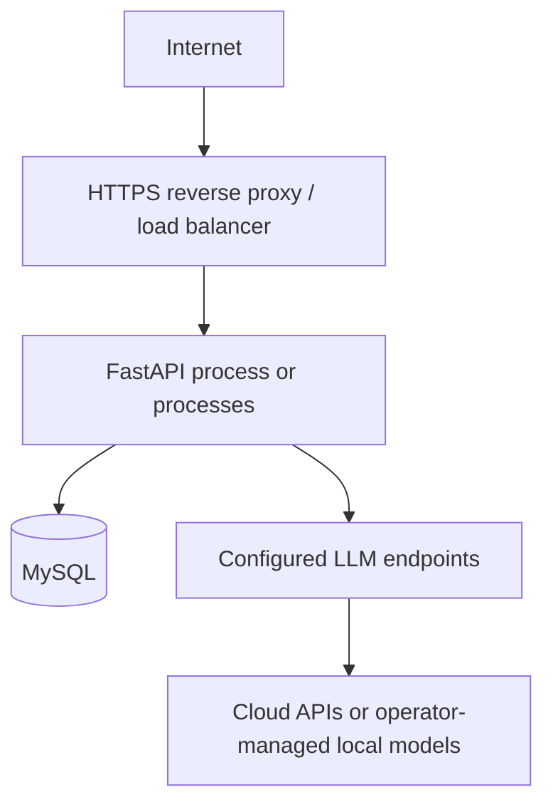

# Crokuta Architecture

- **Status:** Current-state description plus target direction
- **Last reviewed:** 2026-11-26

## 1. Architecture summary

Crokuta is currently a single FastAPI application that serves both static browser assets and JSON APIs. MySQL stores accounts, profiles, authentication sessions, research reports, and conversation messages. The browser stores auth tokens locally and loads conversation history from the API. Research generation is deterministic template logic; chat is routed to a configured cloud or local model through LiteLLM.

The target architecture adds a controlled research-run pipeline, source/evidence records, and background execution. These are future components, not current services.

## 2. System context and trust boundaries

### Actors

- **End user:** uses the web UI or API and provides research/chat input.
- **Instance operator:** deploys the app, configures MySQL and model providers, and controls host-level operations.
- **Model provider:** receives chat prompts and returns model output. Provider privacy and retention are governed by that provider.
- **MySQL service:** stores account, profile, session, conversation, report, and message data.

### Trust boundaries

1. Browser input is untrusted. The API validates request schemas and authenticates protected operations.
2. The browser stores bearer tokens. A compromised browser profile or same-origin script can access local storage.
3. Application-to-MySQL traffic contains account/profile/session and conversation data and must use protected network paths and credentials.
4. Application-to-provider traffic can contain user prompts and research context. Operators must select providers and configure credentials deliberately.
5. Future web retrieval adds an SSRF and prompt-injection boundary. Retrieved pages must be treated as untrusted data.

## 3. Runtime components

| Component | Current responsibility | Main location |
|---|---|---|
| HTTP/API application | Serves UI, auth, research, chat, health, and provider listing routes | `app/main.py` |
| Authentication API | Signup with profile fields, login, refresh, current-user lookup, logout | `app/auth.py` |
| Conversation API | Owner-scoped list, detail, message, and delete operations | `app/conversations.py` |
| Data store | MySQL tables, connection pool, user/session/conversation/message queries | `app/database/auth_store.py` |
| Configuration | Reads environment and `.env` values | `app/config.py` |
| Research engine | Produces a preliminary structured brief without external source retrieval | `app/research.py` |
| LLM gateway | Resolves provider/model/key/base and invokes LiteLLM | `app/llm/gateway.py` |
| API schemas | Validates research and chat requests/responses | `app/schemas/` |
| Browser workspace | Auth form, brief rendering, persistent conversation history and chat | `public/index.html`, `public/static/` |
| Tests | API and auth behavior with deterministic test dependencies | `tests/` |

## 4. Current request flows

### Sign-in and protected request

1. Browser posts full name, phone number, country, email, and password to `/api/v1/auth/signup`; login uses email/password.
2. The app hashes passwords with scrypt and stores identity and profile data in MySQL.
3. Session records store hashes of randomly generated access/refresh tokens, not the raw tokens.
4. The browser holds returned tokens and sends the access token as a bearer credential.
5. The API looks up and validates the token in MySQL before protected research or chat operations.
6. Refresh rotates both tokens; logout deletes the current session.

Access tokens currently expire after 15 minutes; refresh tokens after 30 days.

### Research request and conversation storage

1. Browser sends a question to `POST /research`.
2. The API validates the request and requires an authenticated user.
3. The template research engine builds questions, keywords, areas, and an executive summary.
4. The API stores the report in a new conversation owned by the authenticated user.
5. The response includes the conversation id; the browser renders it and refreshes the server-backed history list.

No external search, fetch, evidence extraction, or claim verification occurs in this flow.

### Follow-up chat and deletion

1. The browser sends a new message to `/api/v1/conversations/{id}/messages`.
2. The API verifies conversation ownership, loads the report and recent stored messages, and saves the user message.
3. The authenticated API passes the assembled context to the LiteLLM gateway.
4. On success, the API stores the assistant response before returning it; provider failure leaves the user message stored and reports an error.
5. Conversation deletion verifies ownership and deletes its messages and report in the same transaction.

The conversation API does not expose request-level API key or API-base overrides.

## 5. Deployment topology

The intended supported shape is one FastAPI deployment behind HTTPS with an externally reachable MySQL database named `research`. The same application code can be operated by the project owner or by a self-hosting user; each installation has separate configuration and database state.

`DATABASE_URL` configures the MySQL connection. Provider credentials and endpoint configuration are environment-based. The current documentation does not certify every hosting platform; serverless deployments, connection limits, and provider network reachability need a platform-specific validation.

## 6. Architectural constraints and known gaps

- The application creates missing tables with SQLAlchemy `metadata.create_all` on the first database operation. Profile, conversation, and message data use new related tables, so an existing auth database can acquire them without altering `users`. There is no migration framework yet; use versioned migrations before evolving existing schemas.
- SQLAlchemy engines and pools are process-local. Each worker/process has its own pool.
- Research reports and chat messages are durable, owner-scoped MySQL records. Browser local storage contains auth tokens, not authoritative conversation history.
- The research engine is synchronous, deterministic, and does not call an LLM or the web.
- There is no job queue, research-run state machine, user quota, billing, or admin console.
- `/health` is a liveness-style response; it does not currently prove database or provider readiness.
- The UI and API share an origin; current design avoids a separate browser API URL/CORS configuration.
- Public signup is enabled. Abuse controls and account recovery are not implemented.
- Existing accounts created before profile storage may have no profile row; they can still log in, but profile fields are returned empty.

## 7. Target evolution

Introduce durable report/run storage and a service boundary before adding autonomous research. Keep the synchronous API for short operations, but move long-running workflows to a bounded worker once retrieval and multi-step research are introduced. A future retrieval pipeline should consist of explicit planning, discovery, safe fetching, evidence extraction, gap analysis, synthesis, and citation validation stages. Persist intermediate state and provenance so partial failures are inspectable and resumable.

Do not split into microservices until measured isolation, scaling, or operational requirements justify the additional deployment complexity.
