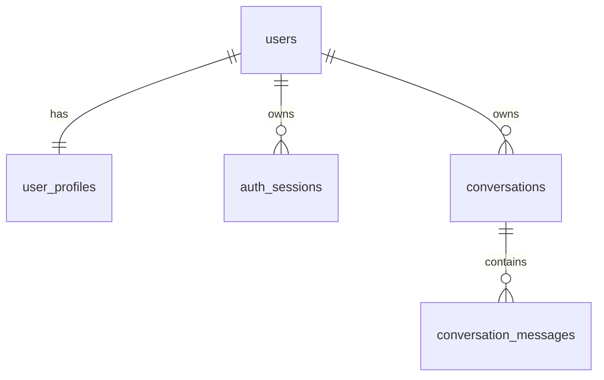

# Crokuta System Design

- **Status:** Current implementation and approved design constraints
- **Related:** [Requirements](requirements.md), [Architecture](architecture.md), [Scaling](scaling.md)

## 1. Design goals

- Keep the present small deployment easy to run and self-host.
- Enforce auth at API boundaries and keep provider credentials on the server where possible.
- Separate HTTP handling, schemas, research logic, persistence, and provider routing.
- Be explicit about the difference between preliminary analysis and source-backed research.
- Add durable workflow state and safe retrieval before calling the product autonomous.

## 2. API surface

| Method | Path | Auth | Current behavior |
|---|---|---|---|
| `GET` | `/` | No | Serves HTML when the client accepts HTML; otherwise returns service metadata |
| `GET` | `/app` | No | Serves the browser workspace |
| `GET` | `/static/*` | No | Serves static assets |
| `GET` | `/health` | No | Returns process-level `healthy`; dependency readiness is not checked |
| `GET` | `/api/v1/auth/config` | No | Reports whether `DATABASE_URL` is configured |
| `POST` | `/api/v1/auth/signup` | No | Creates an account and session; public signup is open |
| `POST` | `/api/v1/auth/login` | No | Verifies credentials and creates a session |
| `POST` | `/api/v1/auth/refresh` | Refresh token | Rotates access and refresh tokens |
| `GET` | `/api/v1/auth/me` | Access token | Returns the current user's id and email |
| `POST` | `/api/v1/auth/logout` | Access token | Revokes the current session |
| `GET` | `/api/v1/llm/providers` | No | Returns a provider catalog |
| `GET` | `/api/v1/conversations` | Access token | Lists the current user's conversations |
| `GET` | `/api/v1/conversations/{id}` | Access token | Returns an owned report and its stored messages |
| `POST` | `/api/v1/conversations/{id}/messages` | Access token | Stores a user message, calls the selected model, then stores its response |
| `DELETE` | `/api/v1/conversations/{id}` | Access token | Permanently deletes the owned report and its messages |
| `POST` | `/research` | Access token | Generates and stores a preliminary brief as a new conversation |

The `/research` route is currently outside the `/api/v1` prefix. The previous unscoped `/api/v1/llm/chat` route was replaced with conversation-scoped chat so new turns are persisted. Version any future breaking API redesign deliberately.

## 3. Authentication and persistence

### Data model

The SQLAlchemy metadata defines five related tables in the MySQL database named `research`:

**`users`**

- `id`: UUID string primary key.
- `email`: normalized email, unique.
- `password_hash`: scrypt hash with per-user random salt.
- `created_at`: UTC timestamp stored as a naive UTC database value.

**`user_profiles`**

- `user_id`: primary key and foreign key to `users.id`, one-to-one relationship.
- `full_name`: required, up to 120 characters.
- `phone_number`: required string, up to 32 characters. Basic format validation is performed; no carrier/country verification is performed.
- `country`: required user-entered country name, up to 100 characters.

**`auth_sessions`**

- `id`: UUID string primary key.
- `user_id`: foreign key to `users`.
- `access_token_hash`, `refresh_token_hash`: SHA-256 digests of high-entropy random tokens.
- `access_expires_at`, `refresh_expires_at`, `created_at`: UTC timestamps.

**`conversations`**

- `id`: UUID string primary key.
- `user_id`: foreign key to the owner in `users`.
- `title`: research topic.
- `report`: JSON snapshot of the structured report, including the conversation id.
- `created_at`, `updated_at`: UTC timestamps; updated when a message is added.

**`conversation_messages`**

- `id`: UUID string primary key.
- `conversation_id`: foreign key to `conversations.id`.
- `role`: `user` or `assistant`.
- `content`: message text.
- `created_at`: UTC timestamp.

Relationship summary:

Raw access and refresh tokens are returned only to the client and are not persisted. The auth tables are created lazily using SQLAlchemy metadata on the first database operation. There is no migration history or automated schema-upgrade path yet.

### Session lifecycle

1. Password length is validated at the API boundary; emails are trimmed and lowercased.
2. Password hashes use Python `hashlib.scrypt` (`N=16384`, `r=8`, `p=1`, 64-byte derived key).
3. Signup rejects a duplicate email with `409`; login returns a generic `401` on invalid credentials.
4. A successful signup/login creates an access token (15-minute lifetime) and refresh token (30-day lifetime).
5. Refresh updates the stored token hashes transactionally and rejects replay of an old refresh token.
6. Logout deletes the session row; protected endpoints query for an unexpired matching access-token hash.

### Persistence boundaries

MySQL stores users, profile fields, sessions, conversations, report snapshots, and user/assistant chat messages. The browser stores auth tokens in local storage; conversation history is loaded from the API. Deleting a conversation permanently removes its messages and report in one transaction. Database backups may retain deleted records until backup retention expires.

## 4. Research contract

`ResearchRequest` accepts a topic with a current schema range of 3-500 characters. `ResearchResponse` contains agent/version, topic/status/type/time, summary, keywords, questions, areas, findings, sources, limitations, and next steps.

The current engine deterministically derives keywords, generic questions, and research areas from the input. It returns no findings or sources and includes explicit limitations that no external source retrieval occurred. UI copy and future reports must preserve this honesty.

Future source-backed research should add separately validated schemas for a research plan, source record, evidence item, unresolved gap, and final report. Avoid changing the current response shape without a versioning or compatibility decision.

## 5. LLM request path

The conversation message API accepts provider, model, new message content, temperature, token limit, and timeout. It loads the owned report and last ten stored messages, builds a system context server-side, saves the new user message, calls `LLMGateway`, then saves the assistant response. `LLMRequest` remains the gateway's internal typed request. The gateway resolves provider model prefixes, environment keys and default local endpoints, then calls LiteLLM. It returns a normalized response including provider, model, content, usage when returned, latency, finish reason, and request id.

Design constraints:

- Keep provider-specific configuration in the gateway.
- Do not log credentials or full private prompts.
- The internal gateway schema permits caller-supplied `api_key` and `api_base`, but the conversation API does not expose those fields.
- Local provider URLs target the server's network namespace, not the user's browser. A future custom-endpoint feature needs SSRF controls and explicit operator policy.
- Provider exceptions currently become gateway runtime errors; maintain useful failure categories without leaking secrets.

## 6. Error behavior

- Pydantic validation errors are returned by FastAPI as client errors.
- Missing/invalid auth produces `401`; missing auth DB configuration produces `503`.
- SQLAlchemy errors in database operations are logged server-side and returned as a generic database-unavailable `503`.
- Research input errors map to `400`.
- LLM configuration errors map to `400`; gateway runtime failures map to `502`.
- `/health` currently does not check dependencies. A separate readiness check should be introduced before relying on orchestration health checks.

Never return an empty report or successful chat response when an underlying dependency failed.

## 7. Security, privacy, and operations

- Require HTTPS outside local development; protect `DATABASE_URL` and provider credentials with deployment secret management.
- Restrict the MySQL account to the application database and restrict network access to application hosts.
- Define backups, restore tests, retention, account deletion, and data-export behavior for stored research content. Conversation deletion removes live rows, but backups may retain copies.
- Keep auth failure responses generic; do not emit password/token values into logs.
- Open signup needs rate limiting/abuse controls before hosted public launch.
- Do not fetch arbitrary URLs until SSRF protection, redirects, DNS/IP checks, timeouts, body-size/content-type limits, and safe parsing are implemented.
- Treat retrieved HTML and model output as untrusted; do not execute code or follow embedded instructions as system policy.

## 8. Future durable research-run model

The target design should persist an owner-scoped run with:

- run id, owner id, input question, state, timestamps, and schema/version;
- explicit plan and configured limits;
- source records with retrieval metadata;
- evidence excerpts and source-quality assessments;
- unresolved gaps and bounded follow-up decisions;
- report output, citations, limitations, and usage metadata;
- error/partial-completion state and correlation ids.

Use explicit states such as `queued`, `running`, `completed`, `partial`, `failed`, and `cancelled`. Define valid transitions and idempotency before implementing retries or workers. Never mark an incomplete run as completed merely because a provider returned a response.

Existing accounts created before profile collection may not have a `user_profiles` row. They remain able to log in and receive blank profile values; signup requires the full profile.
